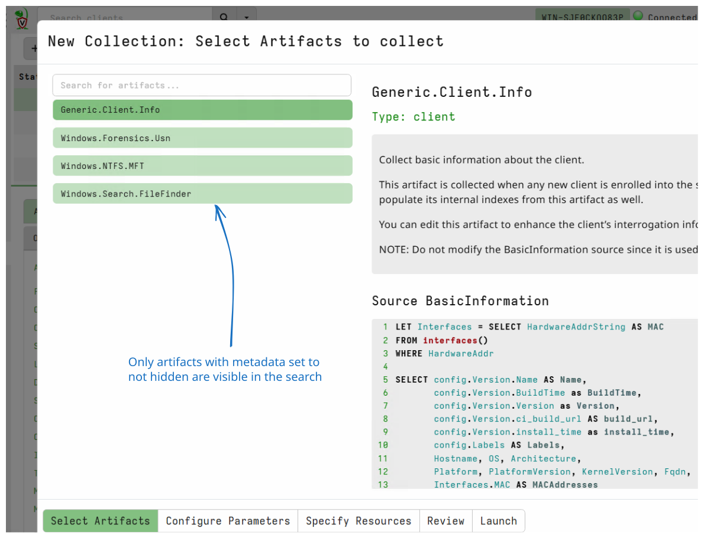
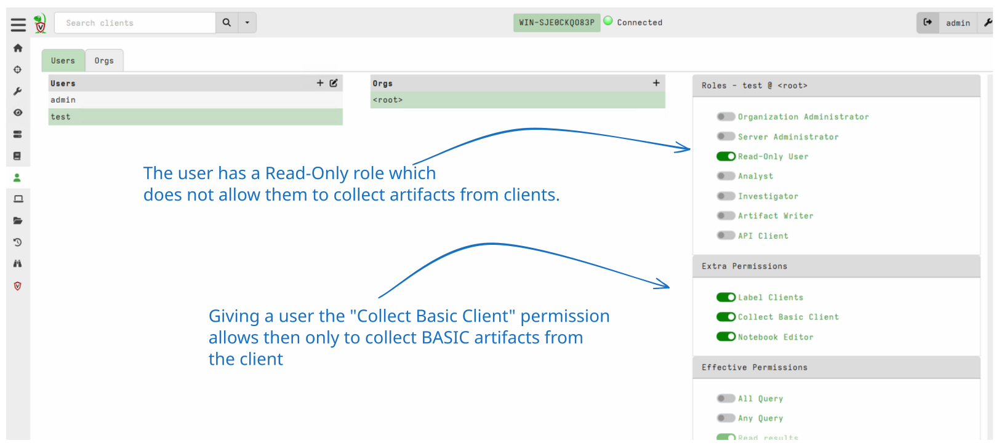
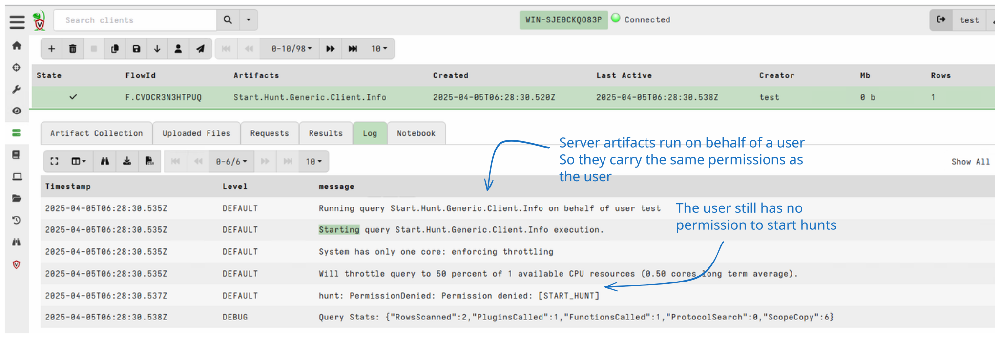
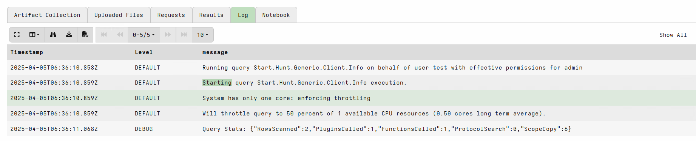

Artifacts are the main way users interact with Velociraptor. You launch an
artifact collection against clients, and then collect the results on the
Velociraptor server.

At its core, an artifact is a way to package VQL queries to make them easier
to use.

For new users the number of artifacts can be overwhelming. Artifacts also
carry real power, so you need to control which users can access which
artifacts. This helps avoid mistakes due to inexperience. For example,
running a `Windows.KapeFiles.Target` collection as a large-scale hunt is
almost always a bad idea.

Most users develop their own operating procedures that specify:

1. Which artifacts to use in which situation
2. Who is allowed to launch more sensitive artifacts
3. How artifacts are used (what type of arguments are allowed)

Velociraptor supports each of these goals.

> [!WARNING] Artifact security is complicated
> Collecting sensitive forensic information from endpoints is a powerful
> permission. The security measures described here are **not
> comprehensive**. An `investigator` role has many escalation paths to take
> over an endpoint, for example by acquiring `lsass.exe` memory or
> downloading the `SAM` or `NTDS.dit` files.
>
> Treat these restrictions as a best effort to avoid accidental errors. The
> true security boundary is the ability to collect artifacts at all.
>
> Do not grant the `investigator` role to users you do not trust. Do not
> grant the `reader` role to users you do not trust to view all collected
> data, including PII and security sensitive data collected as part of the
> forensic process.
>
> Be especially careful when implementing SOAR-like functionality through
> the API. Extending the API to external programs increases the attack
> surface, especially if the SOAR application can schedule collections on
> endpoints. You can limit this risk by marking selected artifacts as
> basic.

## Hidden artifacts

The first goal is to reduce the number of artifacts presented in the GUI.
Velociraptor lets you customize artifacts and import large numbers of them
from external sources such as `Artifact Packs`, so a deployment can hold
hundreds or thousands of artifacts. Many have similar but different
functionality, which overwhelms users with too much choice and makes the
interface confusing.

To clean up the interface, Velociraptor lets you hide artifacts from the
GUI. A hidden artifact does not appear in the search functionality of the
artifact collection wizard or in the artifact list. The artifact still
exists, and it is visible in the output of the `artifact_definitions()`
plugin.

Visibility is stored in the artifact **metadata**, a field attached to each
artifact in the system. You hide or show an artifact with the
`artifact_set_metadata()` function.

###### Example: Making only certain artifacts visible

The following VQL hides all artifacts other than a selected set. Run it in
a notebook:

```vql
LET VisibleArtifacts <= SELECT * FROM parse_csv(accessor="data",
filename='''Artifacts
Windows.Search.FileFinder
Windows.Forensics.Usn
Windows.NTFS.MFT
Generic.Client.Info
''')

SELECT name, name in VisibleArtifacts.Artifacts AS Visible
FROM artifact_definitions()
WHERE artifact_set_metadata(hidden=NOT name in VisibleArtifacts.Artifacts, name=name) OR TRUE
```

Only the listed artifacts then appear in the GUI.



This reduced view guides users toward preferred playbooks and procedures,
which reduces confusion.

## Basic artifacts

Hiding artifacts reduces clutter in the GUI, but it does not stop someone
from launching them, for example with a VQL query. A hidden artifact is
still available, only hidden. Hiding an artifact **is not a security
measure**.

A user's permissions control which actions they can take, both in the GUI
and in a VQL query. If a user can collect artifacts from the client, they
can collect **any** artifact, including hidden artifacts.

Some artifacts are more dangerous than others and require more experienced
operators. Velociraptor grants permissions through a **Role**, or you can
add them directly to the user policy.



In this example the user has the **Read Only** role. This role does not let
the user collect new artifacts from the endpoint, and it does not let the
user update notebook cells, although they can read notebooks.

The user is also granted three permissions on top of that role:

1. **Label Clients**: the user can change client labels.
2. **Collect Basic Client**: the user can collect basic artifacts from the
   client.
3. **Notebook Editor**: the user can update notebook cells, and by
   extension evaluate VQL queries on the server.

If the user tries to collect an artifact from a client, the request is
denied because they do not have the `COLLECT_CLIENT` permission.

You can still allow the user to collect selected artifacts that you
consider safe:

```vql
LET BasicArtifacts <= SELECT * FROM parse_csv(accessor="data",
filename='''Artifacts
Generic.Client.Info
''')

SELECT name, name in BasicArtifacts.Artifacts AS Basic
FROM artifact_definitions()
WHERE artifact_set_metadata(basic=name in BasicArtifacts.Artifacts, name=name) OR TRUE
```

`Generic.Client.Info` is marked as basic, so this user can collect it.

## Controlling access to client artifacts

You can now combine hidden artifacts with basic artifacts to safely limit
what a user can do.

Suppose you want to let a low-privilege user run `ipconfig` on a remote
system. You could give the user access to the `Windows.System.CmdShell`
artifact, which runs commands in the system shell. That is dangerous,
because the artifact accepts arbitrary commands and runs them on the
endpoint.

Instead, reduce the ways in which the `Windows.System.CmdShell` artifact
can be called by **removing the user's choice of artifact parameters**.
Create a new artifact:

```yaml
name: Custom.Ipconfig
sources:
  - query: |
        SELECT * FROM Artifact.Windows.System.CmdShell(Command="ipconfig")
```

Because this artifact takes no parameters, the user cannot change the
command to anything other than `ipconfig`, which you consider safe to run
on any endpoint.

Adding the `basic` metadata to this artifact lets the user launch it,
without any ability to change the parameters or run arbitrary code.

You can use this approach to lock down a standard operating procedure:

- Velociraptor built-in artifacts are powerful and generic, and their
  actions are controlled by many parameters.
- You can write **wrapper artifacts** to narrow the available choices.
- Marking those artifacts as basic lets users run a reduced version of the
  artifact safely.

> [!WARNING] Allowing users to modify artifacts
> Users with the `ARTIFACT_WRITER` permission can modify the artifact
> itself. If a user can change the artifact, the access control described
> here is bypassed.
>
> Treat `ARTIFACT_WRITER` as admin equivalent, because a user with that
> permission can escalate to full admin.

### Restricting dangerous client artifacts

Users without the `COLLECT_CLIENT` permission can launch curated basic
artifacts. A user who has `COLLECT_CLIENT` can launch any client artifact.
The client then runs that artifact without any ACL enforcement. Not every
client artifact is equally safe.

Some client artifacts run arbitrary commands on the endpoint. The
`Windows.System.CmdShell` artifact, for example, runs arbitrary shell
commands, because the command to run is a user-supplied parameter passed
directly to the shell through the `execve()` plugin. An attacker can use
this for a complete domain compromise, for example by running a malicious
command on every asset in the environment.

The `Windows.Sysinternals.Autoruns` artifact also calls the `execve()`
plugin, but it sanitizes its arguments from user input.

An untrusted user may be allowed to collect `Windows.Sysinternals.Autoruns`,
but must be prevented from collecting `Windows.System.CmdShell`.

Because client artifacts have no ACL protection, artifact writers must be
careful not to give users more permissions on the endpoint than intended.

Client artifacts can set the `required_permissions` field to make the
server check that the launching user holds those permissions before it
schedules the artifact. Use this field to restrict collection of powerful,
risky artifacts to administrators.

Sanitize user input as far as possible to restrict the use of dangerous
functions. For example:

1. When you use `execve()`, build the command line from user input without
   letting that input change the meaning of the command.

2. When an artifact uses a plugin that writes to arbitrary files, such as
   `copy()`, do not let the user specify the path and content of the
   files. Otherwise the user can write to startup locations and take over
   the endpoint. The same applies to writing registry keys, deleting
   files, and similar operations.

> [!TIP] Safely using execve()
> The `execve()` plugin launches external commands. It accepts a list of
> parameters called `argv` instead of a single command line, and it
> escapes individual arguments when necessary, so you do not need to
> handle escaping yourself.
>
> Do not launch commands through the shell:
>
> ```vql
> SELECT * FROM execve(argv=["cmd.exe", "/c", "cacls " + DirectoryName])
> ```
>
> Run the target binary directly instead. Velociraptor escapes the command
> line when required.
>
> ```vql
> SELECT * FROM execve(argv=["cacls.exe", DirectoryName])
> ```

How do you know whether a client artifact gives extra permissions to
users? Velociraptor includes a VQL query static analyzer that, among other
warnings, suggests checking permissions:

```text
$ velociraptor -v artifacts verify ./content/exchange/artifacts/*
...
[ERROR] 2025-05-23T11:55:30Z ./content/exchange/artifacts/RemoteIconForcedAuth.yaml: Call to Artifact.Windows.Forensics.Lnk contain unknown parameter Glob
[INFO] 2025-05-23T11:55:30Z ./content/exchange/artifacts/RemoteIconForcedAuth.yaml: Suggestion: Add EXECVE to artifact's required_permissions or implied_permissions fields
```

The artifact verifier checks every plugin and function in an artifact and
confirms that dangerous permissions appear in one of two fields:

1. `required_permissions` restricts who can launch the artifact. Only users
   who already hold that permission can launch it, so the artifact grants
   no additional permissions.

2. `implied_permissions` declares that the artifact handles a permission
   safely. For example, an artifact that sanitizes its `execve()` arguments
   can declare the permission here, which suppresses the warning.

Aim for no verifier warnings.

### Client artifact collection permissions model

When you collect client artifacts, these security features apply:

1. A user without the `COLLECT_CLIENT` permission cannot collect any
   artifact.

2. A user with the `COLLECT_BASIC` permission can collect artifacts marked
   as `basic`.

3. A user with the `COLLECT_CLIENT` permission can collect any client
   artifact, provided they also hold the permissions listed in that
   artifact's `required_permissions` field.

4. Artifacts with open-ended capabilities, such as running arbitrary
   commands, should list a restrictive `required_permissions` field so that
   only users who already hold that permission can collect them. This
   prevents an artifact from granting additional permissions.

5. Artifacts that sanitize the use of a dangerous permission should declare
   it in `implied_permissions`, which suppresses the corresponding verifier
   warning.

## Server artifacts and impersonation

The discussion so far covers client artifacts. Sometimes you also need to
control access to server artifacts. Suppose you want to let the restricted
user create a hunt that contains `Generic.Client.Info`.

Creating a hunt requires the **Start Hunt** permission. Granting that
permission lets the user create **any** hunt, which is dangerous, and you
only want to allow one specific hunt.

The wrapper artifact approach works here as well:

```yaml
name: Start.Hunt.Generic.Client.Info
type: SERVER

sources:
  - query: |
      SELECT hunt(description="A general hunt",
                  artifacts='Generic.Client.Info')
      FROM scope()
```

This artifact starts a hunt. Mark it as basic and the user can launch it.

That still does not work.



Server artifacts run on the server, where ACL permissions are enforced.
The VQL query runs with the user token, so it can only do what the user is
permitted to do. Marking the artifact as `basic` lets the user run it, but
the VQL inside it cannot exceed the user's permissions.

To give the user a controlled privilege to do one specific thing, run the
server artifact with different credentials: impersonate the admin user.

```yaml
name: Start.Hunt.Generic.Client.Info
type: SERVER
impersonate: admin

sources:
  - query: |
      SELECT hunt(description="A general hunt",
                  artifacts='Generic.Client.Info')
      FROM scope()
```

The `impersonate: admin` directive tells Velociraptor to run the artifact
with the permissions of the admin user instead of the launching user. This
is similar to the Linux `setuid` mechanism, except that the effect applies to
one artifact rather than to a binary.



## Artifact obfuscation

When you collect an artifact, Velociraptor compiles it into a set of basic
VQL statements and sends it to the client in a **Collection Request**. The
**Request** tab in the GUI shows the raw request.

The client can see the original query while it runs the request. This is a
risk for sensitive artifacts. A custom artifact that searches for a
sensitive IOC pattern, for example, exposes current threat intel or
threat-hunting methodology to a rogue client, such as a compromised
endpoint running an attacker-controlled Velociraptor client.

Consider this risk when you craft custom artifacts or collect artifacts
that target specific IOCs:

- Never add sensitive information to the artifact definition. The request
  strips the artifact description, comments, and some non-essential parts,
  but variable names remain unaltered.

- Treat artifact parameters as public information. Never send sensitive
  IOCs as artifact parameters. Treat API keys the same way: never write a
  client-side artifact that needs API keys to upload data directly to a
  service provider. A rogue client can intercept artifact parameters.

- If you search for a specific IOC that is sensitive, such as a unique
  name, search for a less sensitive and more generic IOC instead, then
  post-process the results on the server to remove false positives.

  For example, searching for the string `ThreatActorXYZ` is highly
  specific, and the threat actor may realize they are being targeted.
  Search for the regular expression `Threat[^ ]+` instead, then filter the
  false positives on the server.

  This is a trade-off between specific searches that return few high-value
  results, and broader searches that risk more false positives while
  hiding what you are looking for from an adversary.

Velociraptor implements an experimental form of obfuscation for artifact
names, but do not treat it as a security mechanism.
